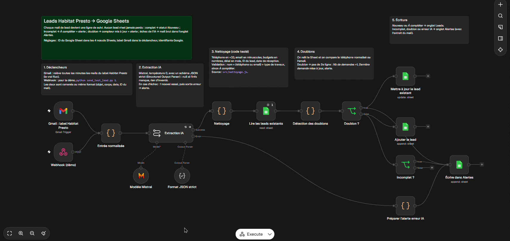
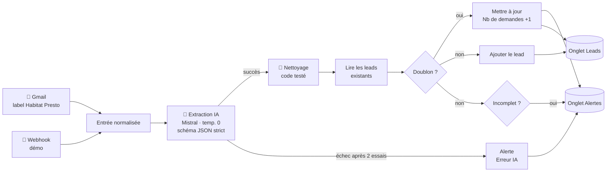
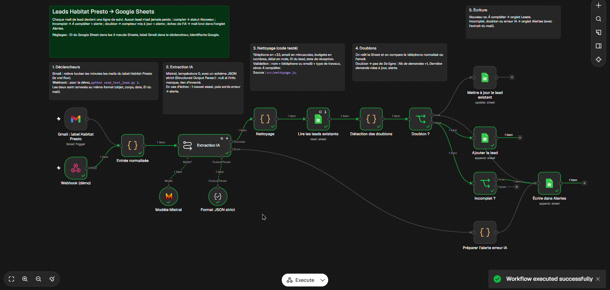
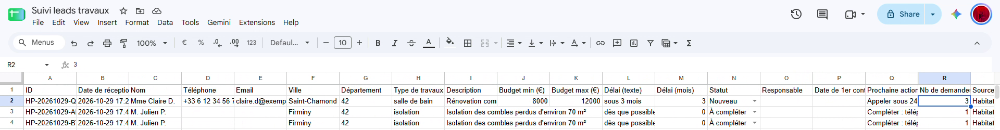
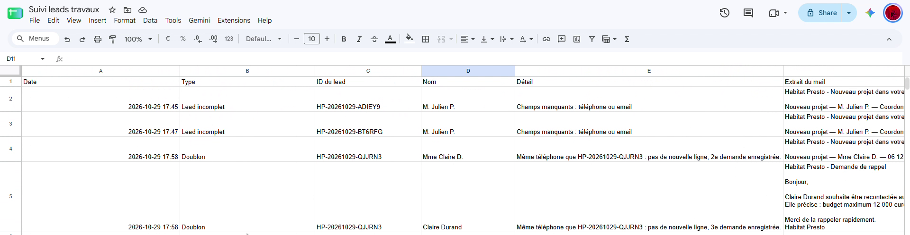
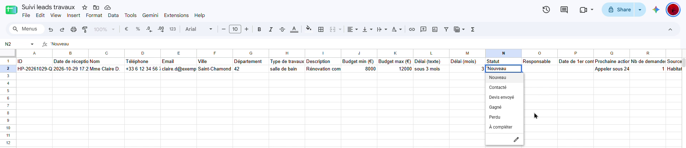

# Leads Habitat Presto → tableau de suivi

**n8n · IA (Mistral) · Google Sheets** — Étude de cas « AI Builder », Month'immo

Le pôle travaux de Month'immo reçoit des leads Habitat Presto par mail. S'ils ne sont pas saisis à la main, ils n'existent nulle part : pas de suivi, pas de relance, des clients perdus.

Ce workflow transforme **chaque mail de lead en ligne de suivi dans un Google Sheet**, en moins d'une minute et sans aucune saisie. Il gère les cas difficiles (lead incomplet, doublon, panne de l'IA) avec une règle simple : **aucun lead n'est jamais perdu en silence.**



🎥 **Vidéo de démonstration (3 min) :** [docs/video-demo.mp4](docs/video-demo.mp4)

---

## Sommaire

- [Fonctionnement](#fonctionnement)
- [Résultat dans Google Sheets](#résultat-dans-google-sheets)
- [Choix de conception](#choix-de-conception)
- [Contenu du dépôt](#contenu-du-dépôt)
- [Installation](#installation)
- [Tester](#tester)
- [Limites et suites](#limites-et-suites)

---

## Fonctionnement



| Étape | Ce qui se passe |
|---|---|
| **1. Déclencheurs** | n8n relève chaque minute les mails du label Gmail *Habitat Presto*. Un **webhook** permet aussi d'envoyer des leads de test à la demande. Les deux entrées sont ramenées au même format. |
| **2. Extraction IA** | Mistral (`ministral-8b-latest`, **température 0**) extrait nom, téléphone, email, ville, département, type de travaux, description, budget et délai. Un **schéma JSON strict** (Structured Output Parser) impose le format : une information absente vaut `null`, rien n'est inventé. |
| **3. Nettoyage** | Code déterministe et testé : téléphone au format `+33 6 12 34 56 78`, email en minuscules, budget en nombres, délai en mois, catégorie de travaux, ID unique, date de réception (heure de Paris). |
| **4. Contrôles** | **Doublon** : même téléphone **ou** même email qu'une ligne existante. **Complet** : nom ET (téléphone OU email) ET type de travaux. |
| **5. Écriture** | Lead nouveau → onglet *Leads*. Incomplet, doublon ou erreur IA → onglet *Alertes*, avec l'extrait du mail. |

### Les cas difficiles

| Cas | Comportement |
|---|---|
| ✅ **Lead complet** | Nouvelle ligne, statut **Nouveau**, prochaine action « Appeler sous 24 h ». |
| ⚠️ **Lead incomplet** | La ligne est **quand même créée**, statut **À compléter**, avec la liste de ce qui manque, et une alerte est écrite. |
| 🔁 **Doublon** | Pas de deuxième ligne : *Nb de demandes* +1, *Dernière demande* mise à jour, alerte. Un client qui relance est un client motivé. |
| ❌ **Erreur de l'IA** | Un nouvel essai automatique, puis le **mail brut** est copié dans *Alertes*. |



---

## Résultat dans Google Sheets

**Onglet Leads.** Une ligne par client. Ici : un lead complet relancé 3 fois (*Nb de demandes* = 3) et un lead « À compléter ».



**Onglet Alertes.** Tout ce qui demande une attention humaine, avec l'extrait du mail d'origine.



**Côté terrain.** Le conducteur de travaux n'a qu'une chose à faire : changer le **Statut** depuis l'appli Google Sheets sur son téléphone. Une ligne restée « Nouveau » plus de 24 h passe en rouge.



---

## Choix de conception

| Choix | Pourquoi |
|---|---|
| **n8n** | Déjà utilisé chez Month'immo : pas d'outil de plus. Visuel, donc compréhensible et modifiable par quelqu'un d'autre. Hébergeable en interne. |
| **Google Sheets** | Gratuit, connu de tous, appli mobile, formules pour les indicateurs. Le bon outil pour valider l'usage avant d'investir dans un CRM. |
| **IA avec sortie structurée** | Le format des mails varie : des règles fixes (regex) cassent. L'IA comprend le texte ; le schéma strict et la température 0 garantissent un résultat exploitable et `null` plutôt qu'une invention. |
| **Mistral** | Société française, hébergement en Europe. `ministral-8b-latest` est rapide, très peu coûteux (< 1 € par mois pour 60 leads) et a extrait correctement tous les leads de test. |
| **L'IA lit, le code vérifie** | Le formatage et la détection des doublons sont du code déterministe, testé hors de n8n (`src/nettoyage.js`). Le générateur copie exactement ce code dans les nœuds : ce qui est testé est ce qui tourne. |
| **Ne jamais perdre un lead** | Chaque échec a une sortie visible : « À compléter », compteur de doublons, onglet *Alertes*. |
| **Webhook en plus de Gmail** | Démontrable à la demande. Le même point d'entrée pourra recevoir d'autres sources (formulaire du site, etc.). |

---

## Contenu du dépôt

```
├── workflow/
│   ├── lead-habitat-presto.json   # le workflow n8n à importer
│   └── generer_workflow.py        # génère le JSON (ID du Sheet, code de nettoyage)
├── src/
│   ├── nettoyage.js               # nettoyage, validation, détection des doublons
│   └── nettoyage.test.js          # 11 tests : node src/nettoyage.test.js
├── sheets/
│   ├── leads-modele.csv           # en-têtes de l'onglet Leads (21 colonnes)
│   └── alertes-modele.csv         # en-têtes de l'onglet Alertes
├── test-leads/                    # 6 mails de test au format Habitat Presto
├── send_test_lead.py              # envoie un mail de test au webhook n8n
├── note-adoption.md               # note d'une page : adoption et mesure
├── script-video.md                # script de la vidéo de 3 minutes
└── docs/
    ├── captures/                  # captures d'écran
    └── video-demo.mp4             # vidéo de démonstration
```

---

## Installation

Prérequis : Docker (ou Node.js 24+), Python 3, un compte Google, une clé API Mistral.

### 1. Lancer n8n

```bash
docker run -d --name n8n -p 5678:5678 \
  -e GENERIC_TIMEZONE=Europe/Paris -e TZ=Europe/Paris \
  -v n8n_data:/home/node/.n8n docker.n8n.io/n8nio/n8n:2.45.6
```

Ouvrir http://localhost:5678 et créer le compte local. Sans Docker : `npx n8n` (Node.js 24 ou plus).

### 2. Créer le Google Sheet

1. Nouveau Google Sheet « Suivi leads travaux ». **Fichier → Importer** `sheets/leads-modele.csv`, renommer l'onglet **`Leads`**.
2. Ajouter un onglet **`Alertes`** et y importer `sheets/alertes-modele.csv`.
3. **Fichier → Paramètres** : France, fuseau horaire Paris.
4. **Statut** (colonne N) : *Données → Validation des données → Menu déroulant* avec `Nouveau`, `Contacté`, `Devis envoyé`, `Gagné`, `Perdu`, `À compléter`.
5. **Rouge après 24 h** : sur `A2:U1000`, *Format → Mise en forme conditionnelle → Formule personnalisée* :
   ```
   =ET($N2="Nouveau";MAINTENANT()-$B2>1)
   ```
   (Sheet en anglais : `=AND($N2="Nouveau",NOW()-$B2>1)`)

### 3. Identifiants

- **Google (Gmail + Sheets)** : dans Google Cloud Console, activer *Gmail API*, *Google Sheets API* et *Google Drive API*, configurer l'écran de consentement OAuth (utilisateur test = votre adresse), puis créer un **ID client OAuth** de type *Application Web* avec l'URI de redirection `http://localhost:5678/rest/oauth2-credential/callback`. Dans n8n, créer les identifiants **Google Sheets OAuth2 API** et **Gmail OAuth2 API** avec ce Client ID / secret.
- **Mistral** : créer une clé sur https://console.mistral.ai, puis l'identifiant **Mistral Cloud API** dans n8n.

### 4. Importer le workflow

```bash
python workflow/generer_workflow.py --sheet-id <ID_DU_SHEET>
```

L'ID se trouve dans l'URL du Sheet, entre `/d/` et `/edit`. Dans n8n : **Create → Workflow → … → Import from File** → `workflow/lead-habitat-presto.json`.

Ouvrir ensuite chaque nœud Gmail, Mistral et Google Sheets pour y sélectionner l'identifiant correspondant, et choisir le label **Habitat Presto** dans le nœud Gmail.

### 5. Brancher les vrais mails

Dans Gmail : créer le label **Habitat Presto** et un filtre *De : adresse d'Habitat Presto → Appliquer le libellé*. Activer le workflow (interrupteur **Active**).

---

## Tester

### La logique de nettoyage, sans n8n

```bash
node src/nettoyage.test.js
```

### Le workflow complet

Dans n8n, cliquer sur **Execute workflow**, puis :

```bash
python send_test_lead.py 1          # mode test : un envoi par clic sur Execute workflow
python send_test_lead.py 1 --prod   # workflow activé : envois enchaînés
```

| Lead | Scénario | Résultat attendu |
|---|---|---|
| `1` | Exemple officiel | Ligne **Nouveau**, `+33 6 12 34 56 78`, budget 8 000 – 12 000 €, délai 3 mois |
| `2` | Autre format (plusieurs lignes, « 15k€ », « +33 (0)7… ») | Ligne **Nouveau**, extraction correcte |
| `3` | Ni téléphone, ni email, ni budget | Ligne **À compléter** + alerte « Lead incomplet » |
| `4` | Même mail que le 1 | Pas de nouvelle ligne, *Nb de demandes* = 2, alerte « Doublon » |
| `5` | Même numéro écrit autrement, autre formulation | Pas de nouvelle ligne, *Nb de demandes* = 3, alerte « Doublon » |
| `6` | Toiture, nouveau client | Ligne **Nouveau** |

---

## Limites et suites

**Limites du prototype**
- Tourne en local : si la machine est éteinte, les mails sont traités au redémarrage (pas de perte, mais du retard). En production : serveur ou n8n Cloud.
- Testé sur 6 mails fictifs, pas encore sur un historique réel.
- Un client qui change à la fois de téléphone **et** d'email n'est pas reconnu comme doublon.
- Pas encore d'alerte en cas de panne du workflow lui-même.

**Prochaines étapes**
1. Rappel automatique au conducteur si un lead reste « Nouveau » plus de 24 h, et récapitulatif chaque matin.
2. Workflow d'erreur n8n qui prévient par mail en cas de panne.
3. Rejouer un mois de vrais mails pour mesurer le taux d'extraction correcte.
4. Brancher d'autres sources (formulaire du site, autres plateformes) sur le même tableau.
5. Passer sur Coda ou un CRM si l'usage est validé : seuls les nœuds d'écriture changent.

**Données personnelles.** Données de prospects ayant fait une demande (base légale : mesures précontractuelles). Accès au Sheet limité aux personnes concernées, durée de conservation définie, inscription au registre des traitements. En production, offre payante de Mistral (données non utilisées pour l'entraînement).

L'adoption et les indicateurs de suivi sont détaillés dans [note-adoption.md](note-adoption.md).
